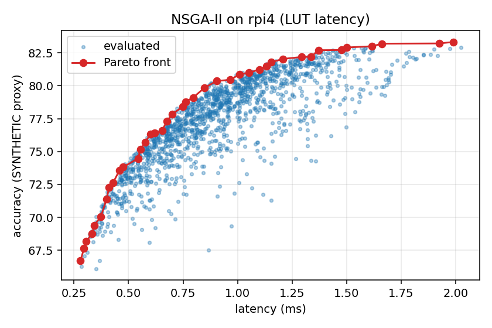

# hwnas - Hardware-Aware NAS for the Edge (teaching toolkit)

A small, readable implementation of the ideas in the *Hardware-aware NAS for the edge* lectures.

## Read this first: what is real and what is a placeholder

* **Device profiles** (`hwnas/devices.py`) are illustrative roofline models (`mcu`, `rpi4`, `edge_gpu`).
  They are *not* measurements of any board. They are tuned so that the three devices disagree about which
  operators are cheap. For real work, build a measured LUT on your target (`python -m hwnas.cli measure-lut`).
* **`SyntheticAccuracy`** is a deterministic made-up function. It lets search algorithms run in seconds, but
  its numbers are **not accuracy**. Real accuracy comes from the differentiable super-net, short-training
  proxies, or a benchmark (see `docs/LAB.md`, Lab 5).
* The analytic cost model **is exact**: parameter and MAC counts are checked against real PyTorch networks in
  `tests/test_torch.py`.

## Install

```bash
pip install -e .                 # numpy only: search, LUT, cost model, CLI
pip install -e ".[viz]"          # + matplotlib for plots
pip install -e ".[torch,dev]"    # + PyTorch/torchvision (super-net, measurement, training) and pytest
pytest -q                        # numpy tests always run; torch tests are skipped if torch is missing
```

## Quick tour (no GPU, no data, seconds)

```bash
python -m hwnas.cli additivity --device edge_gpu        # how wrong is a LUT? how much does a predictor fix it?
python -m hwnas.cli search --device mcu --latency-ms 25 --sram-kb 96 --budget 600
python -m hwnas.cli pareto --device rpi4 --out pareto.png
python -m hwnas.cli devices --out devices.png           # same relative budget, three devices
python examples/convergence.py                          # random vs evolution, 10 seeds
```

Differentiable search and training (needs PyTorch; CIFAR-10 downloads on first use, GPU recommended):

```bash
python -m hwnas.cli measure-lut --out luts/host_cpu.json            # run this ON the target device
python -m hwnas.cli diff-search --lut luts/host_cpu.json --epochs 30 --warmup 5 --lat-loss fbnet --out found.json
python -m hwnas.cli train found.json --epochs 30
python -m hwnas.cli diff-search --epochs 2 --warmup 1 --fake        # 1-minute smoke test, random data
```

## What you should see (numbers from the committed code, synthetic accuracy)

* **LUT additivity error** (300-ish random architectures): `mcu` ~0%, `rpi4` ~2%, `edge_gpu` ~22% MAPE
  (Kendall tau about 1.00 / 0.99 / 0.94-0.95). A ridge corrector trained on 200 samples brings it to ~0%.
  Lesson: the more asynchronous/overlapping the runtime, the less additive the LUT.
* **Search**: at a 0.85 ms budget on `rpi4`, evolution reaches 79.6 +/- 0.2 proxy-accuracy vs 78.8 +/- 0.3 for
  random search at the same evaluation budget (10 seeds). See `docs/figures/convergence.png`.
* **Same relative budget, different device, different network** (`docs/figures/devices.png`): the GPU-like
  profile (high per-layer launch cost, slow depthwise) prefers *fewer, fatter* layers (it skips layers), while the
  MCU and CPU profiles keep more layers with smaller expansion ratios.




## What has and has not been verified

* `pytest -q`: **28 tests pass** (18 numpy-only + 10 torch) with PyTorch 2.14.1 on CPU. The torch tests check that the
  analytic parameter and MAC counts equal those of the real PyTorch networks, that the super-net's expected latency
  equals the LUT latency for a one-hot choice, and that the latency-loss gradient moves probability toward cheaper operators.
* **Differentiable search mechanics** (random data and random labels, so there is *no accuracy signal*; 8 epochs, `rpi4`
  LUT, all-`k5_e6` network = 2.09 ms, hinge target = 1.25 ms): no latency term -> derived network 1.43 ms;
  hinge (lam=20) -> 0.73 ms; FBNet loss -> 0.36 ms. This shows the latency term steers the search; with real data
  the accuracy term pushes back and the results will be less extreme (the hinge loss then settles near the target).
* `measure-lut` runs on the host CPU (the sandbox used to build this repo); its per-operator ranking agrees only moderately
  with the simulated `rpi4` LUT (Kendall tau 0.83) - which is exactly why you should measure on your own target.
* **Not run here:** CIFAR-10 download and full training (no dataset access or GPU in the build environment), and any
  measurement on real edge hardware. Expect to tune `lr_a`, `tau` schedule and epochs on real data.

## Repository layout

```
hwnas/            library (space, cost, devices, latency, accuracy, search, viz, cli; torch_nets, supernet,
                  diff_search, measure, train, proxies, data)
tests/            pytest suite (cost model vs real PyTorch, constraints, Pareto logic, gradient direction, ...)
examples/         convergence experiment
notebooks/        student lab notebook
docs/LAB.md       five guided labs with questions and stretch goals
docs/DESIGN.md    design decisions and known limitations
```

## References

Tan et al., *MnasNet* (arXiv 1807.11626) - Wu et al., *FBNet* (1812.03443) - Cai et al., *ProxylessNAS*
(1812.00332) - Cai et al., *Once-for-All* (1908.09791) - Lin et al., *MCUNet* (2007.10319) - Li et al.,
*HW-NAS-Bench* (2103.10584) - Deb et al., *NSGA-II* (IEEE TEVC 2002) - Tanaka et al., *SynFlow* (2006.05467).
